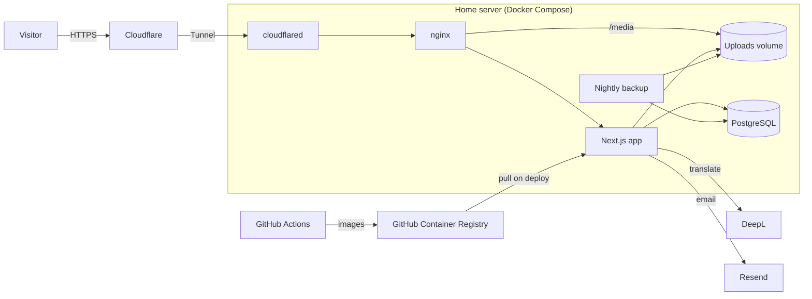

# loklinnord.com — bilingual travel blog & portfolio

**Live:** [loklinnord.com](https://loklinnord.com)

A full-stack web app I designed and self-host on a home Linux server. It's where I write about my travels in
**English and Japanese**, share private updates with family, and show the projects I've built — including this one.

> This repository is the source code for my personal site. It isn't a template or a packaged product.
> © Loklin Nord — all rights reserved.

---

## What it does

### For visitors
- **Blog and portfolio** laid out from rich, photo-led blocks: hero covers, full-width banners, image + text
  splits, rows of three portrait phone photos, rich text, and uploaded or YouTube video.
- **English / 日本語** throughout, with a language switcher and language-specific URLs (`/en/…`, `/ja/…`) that
  search engines index separately.
- **Mailing list** with double opt-in, an email when a new post is published, and one-click unsubscribe.
- **Contact form** that delivers straight to my inbox, with spam protection.
- Responsive from phones to wide screens, with light and dark themes.

### For family
- **Invite-only accounts** — no public sign-up. Sign-in is passwordless: a one-time link is emailed.
- **Private, threaded comments** on posts, visible only to signed-in family members.
- **Profiles** with a display name and a photo, positioned and zoomed in a cropper with a circular preview.

### For me (the admin portal)
- **Block-based post editor**: add, reorder and delete blocks; edit text inline with a rich-text editor;
  save drafts; preview exactly as readers will see it; publish or unpublish.
- **Write in either language, translate on demand.** One click sends the post through DeepL; I review and edit
  the result before publishing. Re-translating only touches fields whose source text changed, so my manual
  fixes to translations are never overwritten.
- **Photo cropping before upload**, framed to each block's shape.
- **Video uploads** transcoded in the background to a format every browser plays.
- **Family invite management**, subscriber list, and an inbox of contact messages.

---

## Tech stack

| Area | Technology | Why |
| --- | --- | --- |
| Framework | **Next.js 16** (App Router, React Server Components, Cache Components), **React 19**, **TypeScript** | Server-rendered pages that load fast and are readable by search engines; types end to end. |
| Styling | **Tailwind CSS 4** with design tokens | The whole palette and font set are a few variables, with automatic dark mode. |
| Database | **PostgreSQL 18** + **Prisma 7** | Relational data (posts, comments, users, invites) with type-safe queries and versioned migrations. |
| Auth | **Better Auth** (magic links) | Passwordless sign-in suits family members; invite-only rules are enforced in database hooks. |
| Editor | **Tiptap** | A lightweight rich-text editor limited to the formatting the site supports. |
| Media | **sharp**, **ffmpeg**, **react-easy-crop** | Image resizing/cropping to WebP and video transcoding, with metadata stripped. |
| Translation | **DeepL API** | High-quality EN⇄JA translation, called only when I ask for it. |
| Email | **Resend** | Transactional email and newsletters from my own domain. |
| Hosting | **Docker Compose** on a home Linux server, **nginx**, **Cloudflare Tunnel** | Self-hosted with no open ports for the website, free HTTPS, and the server's IP kept private. |
| CI/CD | **GitHub Actions** → **GitHub Container Registry** | Every push is linted, type-checked and tested, then built into images the server pulls. |

---

## Architecture



- **nginx** serves uploaded photos and video directly from disk, so the Node.js app only renders pages.
- **Cloudflare Tunnel** is an outbound connection from the server, so no inbound ports are open for the website
  and it keeps working if the home IP address changes.
- **Two images** are built per commit: the site, and a small *migrator* that applies database migrations on
  every deploy before the new version starts.
- **No secrets in images.** The images are built publicly; credentials exist only in an environment file on
  the server and are injected when the containers start.

---

## Engineering highlights

**Caching that stays correct.** Public pages are prerendered and cached using Next.js Cache Components. Every
database read goes through one data module ([`src/lib/content.ts`](src/lib/content.ts)); publishing or editing a
post invalidates the cache by tag, so changes appear immediately. Anything personal — login state, family
comments — is streamed per request inside `<Suspense>` and never cached. The production build needs no database
at all, which keeps CI simple and private data out of the build.

**Invite-only, enforced twice.** Magic links are only emailed to existing accounts, the admin, or addresses
holding a valid invite; everyone else receives an identical response, so the form can't be used to discover who
has an account. Independently, a database hook refuses to create any account without a valid, unexpired,
single-use invite. Invite tokens are stored only as SHA-256 hashes. ([`src/lib/auth.ts`](src/lib/auth.ts))

**Translation that respects human edits.** Each translatable field records a fingerprint of the source text it
was translated from. Re-translating sends only fields whose source changed, leaving manual edits elsewhere
untouched. This is covered by unit tests. ([`src/lib/translate.ts`](src/lib/translate.ts),
[`tests/translate.test.ts`](tests/translate.test.ts))

**Privacy by default for media.** Phone photos and videos carry GPS coordinates. Every image is decoded,
re-oriented, optionally cropped and re-encoded with *no* metadata; every video is transcoded to H.264 with all
metadata dropped. Verified with test files carrying GPS tags. ([`src/lib/uploads.ts`](src/lib/uploads.ts))

**Cropping on the server, chosen in the browser.** The cropper only records a rectangle; the server crops the
full-resolution original after applying EXIF rotation, so there is no double compression and sideways phone
photos crop where expected. One crop component serves both round profile photos and editor image slots.

**Safe rich text.** Editor output is sanitized on the server against a small allowlist on every save, so it can
be rendered safely. Server Actions re-check authorization themselves rather than trusting the UI.

**Email done properly.** Double opt-in, RFC 8058 one-click unsubscribe headers, a guard that makes a
"new post" email impossible to send twice, and confirm/unsubscribe pages that act on a button press, so
email link scanners can't trigger them.

---

## How it was built

**1. Requirements.** I started from a written spec: a travel blog that doubles as an about-me and portfolio site,
bilingual, with family-only comments, a block-based post builder, a mailing list and self-hosting on my home
server.

**2. Decisions before code.** Working through the spec raised questions that changed the design:

| Question | Decision |
| --- | --- |
| How should the public reach a server in someone's home? | **Cloudflare Tunnel** instead of router port forwarding: no open ports, free HTTPS, IP stays private. |
| Which auth library? | **Better Auth** over the originally planned Auth.js: first-class magic links, and database hooks that made invite-only rules simple to enforce. |
| How do family members sign in without passwords, without letting strangers sign up? | Magic links, gated by single-use invites tied to one email address. |
| Translate automatically on publish? | **No** — translate on demand so I can review and edit before publishing, and only re-translate what changed. |
| Translation storage? | One block layout per post with `{ en, ja }` text in each block, so the two languages can't drift apart. |
| Where are images built? | In **CI**, not on the home server. |
| What about photo metadata? | Strip it from everything — travel photos taken at home would otherwise publish my address. |

**3. Building in layers.** Data model → auth → public pages → the admin editor → translation, email and media
pipelines → containers and CI/CD. Each layer was verified before moving on: security checks (unauthorized sign-in
attempts, revoked invites, path traversal), metadata stripping on real test files, newsletter de-duplication,
and production builds with the database deliberately unreachable.

**4. Shipping.** DNS moved to Cloudflare, the tunnel connected, transactional email verified on my domain, and
the server hardened (key-only SSH).

**Built with AI pair-programming.** I built this with Claude Code as a pair programmer. I set the requirements and
made the product, design and architecture decisions; Claude proposed approaches, wrote much of the code with me,
and we tested each step together. I've since documented, deployed and operate the system myself.

---

## Quality

- **CI on every push:** ESLint, TypeScript type-checking and unit tests must pass before images are built.
- **Unit tests** with Node's built-in test runner.
- **Strict types** across the stack, including generated route types and Prisma models.
- **Operations:** nightly database and media backups, versioned database migrations applied automatically on deploy.

---

## Repository layout

```
src/app/[lang]/     public site (English / Japanese)
src/app/admin/      admin portal and post editor
src/app/api/        auth, media upload, unsubscribe endpoints
src/components/     UI components
src/lib/            data access, auth, uploads, translation, email
prisma/             schema and migrations
deploy/             server configuration
tests/              unit tests
```
